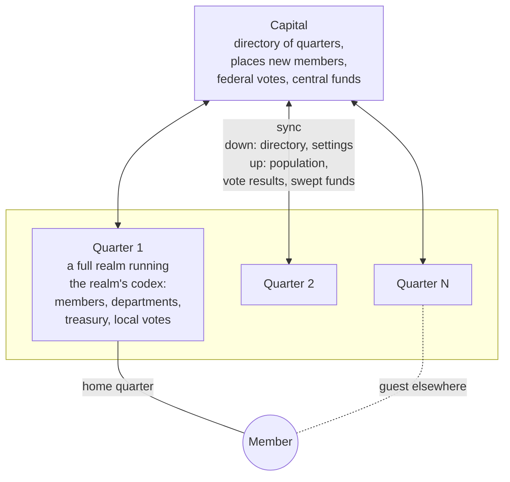
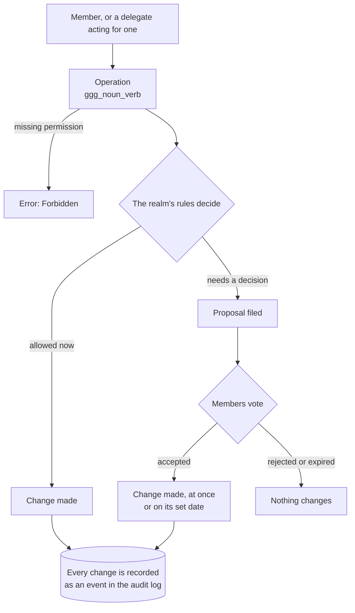

# Generalized Global Governance (GGG)

GGG is a standard for Governance Operating Systems (GOS) running on the [Internet Computer Protocol(ICP)](wwww.internetcomputer.org).

Governance is ...
An Operating system is ..

A GOS is software that transparently and verifiably runs the governance processes of a city or a country, from government to public administration

GOS enables the mergence of coopreation, which is the natural. that corruption is harder to conceal and cooperation can scale.

GGG describes the entities, processes and conventions that a GOS should implement. For example, GGG calls each place a GOS governs a **realm**: a city, a region, a country, or any other community that governs itself.

GGG aims the following goals:

1. **Implementation-agnosticism:** it says what a GOS does, not how a GOS stores or runs it. The only requirement is that it must run on the Internet Computer.

2. **Interoperability:** any GGG-compliant GOS or tool works out-of-the-box with any GGG-compliant GOS or tool.

3. **Familiar but abstract:** close enough to traditional governance that existing institutions map onto it, yet general enough not to be tied to any one country or to limit governance evolution.

**This page is the whole specification.** [`ggg.did`](ggg.did) is the same thing in Candid, the interface description language (IDL) for the ICP, and is normative for exact types and signatures. Where this page and `ggg.did` disagree, one of them needs fixing.

## Architecture

An Operating system is typically consists of ...
Kernel I/O Internal resource management Internal process communication System utilities and libraries P rocess management Security and access control, booting

we can draw analogies to governance:

- **Realm:** the community a GOS governs.
- **Quarter:** part of a large realm, run as a realm of its own and coordinatedsplit  by a capital.
- **User:** a person or an agent, identified by an Internet Computer principal, who becomes a member by joining a realm.
- **Permission:** the right to perform an operation, held directly or through a profile or department. Members can let a delegate act for them.
- **Organizations:** bodies outside the realm's government, such as companies, parties, unions and associations.
- **Departments:** the realm's own bodies, in a tree under a root department, each deciding by its own voting policy.
- **Codex:** the realm's legislation as code inside the GOS

### Quarters

ICP architecture conditions GGG arthitecture: large canisters, split by user
- Canister's resources are large (memory, storage)
- Intercanister communication is slow

Phylosophical reasons:
corruption is harder to conceal and cooperation can scale => it should be possible for users to fork a GOS easily, the architecture should facilitate that

that's why we need quarters

# Domains

# Layers

codex propagatoin and inheritance

splitting and merging

# Permissioning

## Operations

Everything happens through **operations**, the methods of `ggg.did`, named noun then verb, such as `ggg_proposal_vote` or `ggg_budget_draft`. Reads never change anything. An operation either succeeds or returns an error, and a refusal can name the permission that was missing.

**Decisions.** When the realm's rules reserve a change for a decision, the operation files a **proposal** instead of making the change. The members entitled to vote, in the whole realm or in one department, decide it under a threshold and quorum fixed when voting opens. An accepted proposal takes effect at once, or on a date set when it was filed.

**Delegation.** A member can let a delegate act for them, limited to chosen groups of operations and to a period. Some operations still wait for the member's own approval each time.

**Legislation.** The codex attaches rules to operations. A realm can also take legislation from other realms, such as its region or its country, when both sides agree by vote, and GGG records whether it runs the latest release in force.

**Records.** Every change is recorded as an **event**: what was done, by whom, for whom and under which grant. Private documents are encrypted, and only people given a key can read them.

# Tasks

# onboarding / status

## Examples

democratic vote

===========

realmgos:

cedar
Python encoding of legislation into codex
(engine)
extensions

