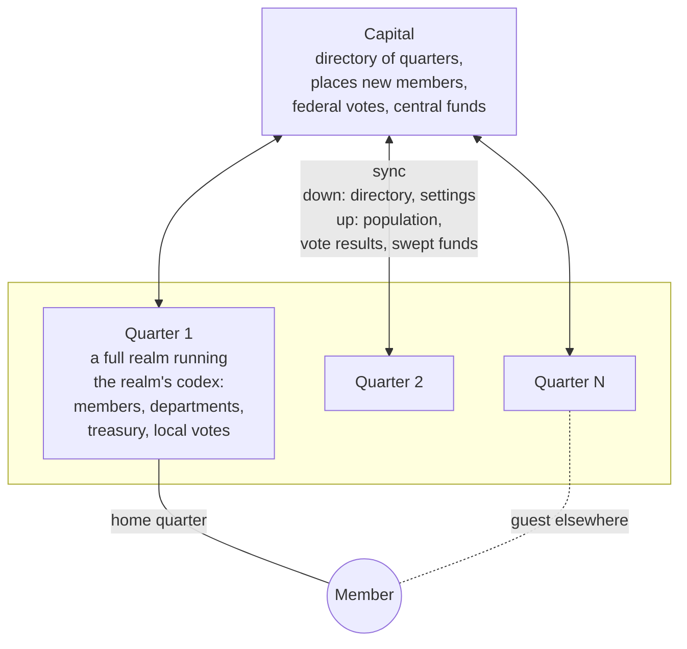
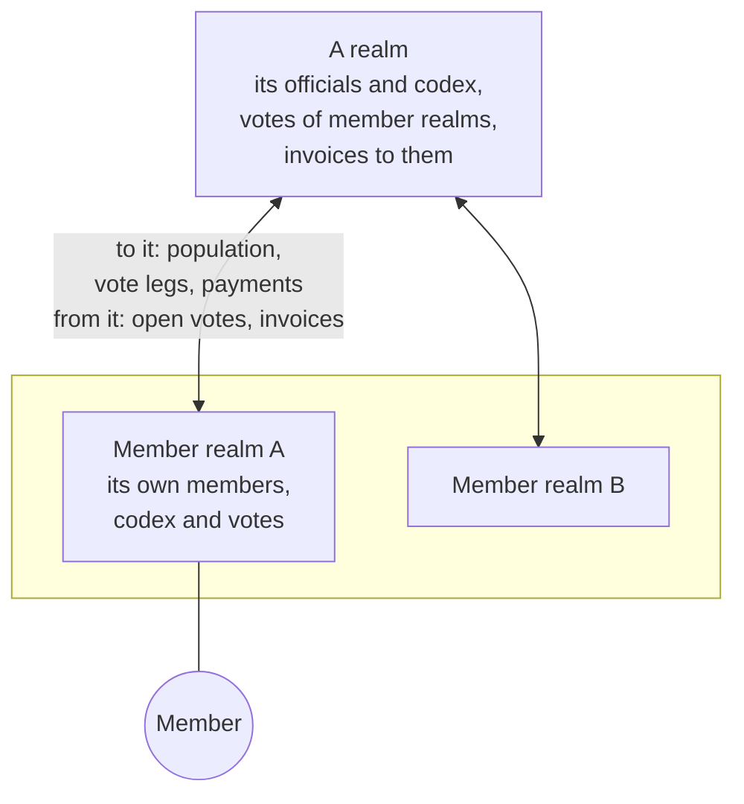
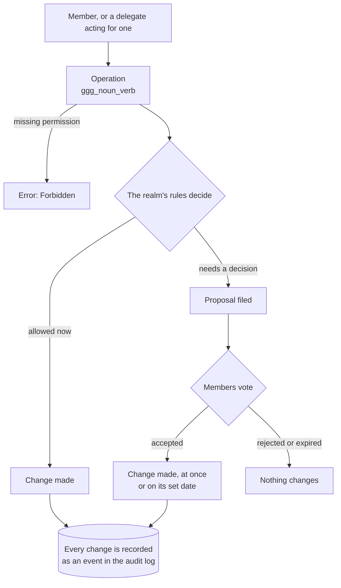

# Generalized Global Governance (GGG)

## Definitions

GGG is a standard for Governance Operating Systems (GOS) running on the [Internet Computer Protocol (ICP)](https://internetcomputer.org).

**Governance** is how a community makes and carries out its decisions: who may decide what, under which rules, and how it is recorded.
An **operating system** is the software that manages a computer's resources and lets programs share them safely.

A GOS is software that transparently and verifiably runs the governance processes of a city or a country, from government to public administration.

A GOS lets cooperation emerge, as it naturally does: corruption is harder to conceal, and cooperation can scale.

## Goals 

GGG is a GOS ontology with the following goals:

1. **Implementation-agnosticism:** it says what a GOS does, not how a GOS stores or runs it. The only requirement is that it must run on the Internet Computer.

2. **Interoperability:** any GGG-compliant GOS or tool works out-of-the-box with any GGG-compliant GOS or tool.

3. **Familiar but abstract:** close enough to traditional governance that existing institutions map onto it, yet general enough not to be tied to any one country or to limit governance evolution. See [Reference countries](#reference-countries).

In other words, GGG shall describe the most relevant entities, processes and conventions of traditional governance systems so they can be implemented on the Internet Computer using any programming language and tech stack available allowing working out-of-the-box with other GGG-compliant systems like GOS, MCP clients/servers, etc.

**This page is the whole specification.** [`ggg.did`](ggg.did) is the same thing in Candid, the interface description language (IDL) for the ICP, and is normative for exact types and signatures. Where this page and `ggg.did` disagree, one of them needs fixing.

## Design rationale

This part is the reasoning supporting decisions made in this standard as well as the general principles followed.

**1. The model holds logic, not labels.** GGG implements logic derived from legislative texts. If something cannot be turned into logic, GGG does not cover it. A field recording what someone asserts, which no rule can check, is not governance — it is a form. **What GGG does not cover it should refuse, not record.** *Test:* Name the rule that reads the field and the decision it makes. If no rule can, the field does not belong.

**2. Legislation describes a process; code executes one.** Legislation describes a process with the technology of its day: registers were books, notice was paper, identity was a clerk recognising a face. Separate the **obligation** (what the rule protects — binding) from the **procedure** (the means — replaceable by any means that serves the obligation at least as well). *Test:* Ask what the rule protects. If the means can change without defeating that, the means is technology, not legislation.

**3. Faithful is not correct: scrutinise the logic.** Texts amended by many hands over decades contain rules that contradict each other, rules whose conditions are unreachable, and rules left behind by repeal. Code applies an incoherent rule every time, instantly, at scale. Scrutiny produces a **finding raised openly**, never a quiet correction: the codex author has no authority to improve the legislation. *Test:* If someone compared the text with the codex, would every difference be one you could point to and justify?

**4. Prevention is better than regulation.** Legislation regulates what it cannot prevent, so it provides for detection, challenge and penalty after the fact. A realm can make the act unexecutable, and then there is no breach to detect. But prevention must be **total** — it says nothing about the world outside the realm — and a refusal is still a record where what the rule protects is that attempts are visible. *Test:* Can the realm make the act unexecutable everywhere the rule reaches? Then the machinery around it is dead code. Only here? Then keep both.

**5. Where the text and the code differ, the text prevails.** The legislation is the authority; the codex is a reading of it. An ambiguity is settled by reading the text again, never by appealing to what the code already does. A codex that diverges is **wrong** — a defect to fix in the codex. Where the text admits two readings, the codex takes one and records which. *Test:* If the provision and the codex disagree, which one changes? The codex. Always.

**6. Every rule cites the provision it comes from.** Every member of a chapter carries a reference to the part of the legislation it implements, through `legislation="..."`. Cite the provision, not the instrument: `Ley 39/2015 Art. 21.3`, never `Ley 39/2015`. Where a member implements no provision, say so, so that an empty citation means "nobody filled this in" and nothing else. *Test:* Can a reader open what the citation names and see this rule in it? A citation they must go searching from is not a reference.

**7. GGG is common ground; the particular goes in a layer.** GGG holds what holds nearly everywhere; everything particular to a jurisdiction belongs in a codex layer. This rules out borrowing a jurisdiction's **structure** as well as its categories: German statutes run `Buch > Abschnitt > Titel > §`, Spanish ones `libro > título > capítulo > sección > artículo`, and the same word does not keep its rank — a Spanish `sección` sits below a `capítulo`, while a section of a UK Act is the provision itself. So GGG names the **subject**, which every jurisdiction has, and stays out of naming divisions, which none of them share. *Test:* Does the rule, field or vocabulary name a jurisdiction's statute, agency or legal categories — directly, or through values only that jurisdiction uses? Then it is a layer, not the model.

**8. Model the fact, not the claim about the fact.** Where a rule depends on something being true of the world, hold the thing that makes it true, not a party's statement that it is. Prefer, in order: a reference to an entity the realm already holds; a recorded fact written when the thing happened, by an operation with its own permission; a claim, only where the model has decided explicitly that this is outside what it covers. *Test:* Could a rule have reached a different answer if the person had typed something else, with nothing else about the realm being different? Then it is a claim.

**9. An entity earns its place by being read.** Every entity, field and status should be named by some rule, operation or invariant that reads it. A field nothing reads is a comment with a schema: it costs every implementation, every interface version and every migration, and buys what a free-text field would have held.

**10. How GGG is written.** **A GGG word keeps its GGG meaning** — **Short pages:** this specification is one page of at most 500 lines. **Simple English:** short sentences, common words, one idea at a time — a rule only a fluent reader can parse will be implemented wrongly. *Test:* Read it as someone who knows governance, but not GGG, and not much English. Can they say what the realm must do?

## Proposing a change

Before you add an entity, field, status or operation, show that:

1. a rule or operation reads it (principle 9);
2. you know what it protects (principle 2);
3. it holds in the [reference countries](#reference-countries), not in one country only (principle 7);
4. it records a fact, not a claim (principle 8);
5. it cites the provision it comes from (principle 6).

Then change `ggg.did` and this page together, in one change. If it breaks compatibility, raise the version.

## Reference countries

GGG draws its examples from six countries in three groups. Each group plays a different role.

| Group | Countries | Role |
|---|---|---|
| EU civil-law democracies | Spain, Germany | **The base.** GGG must fit both. They also share a layer above them: the EU. |
| Common-law democracies | United States, United Kingdom, India | **The contrast.** A concept should work here too. If it does not, it is probably a European habit, not common ground. |
| One-party state | China | **The stress test** for administrative machinery, such as scale, deep layers and digital services. Never for how decisions are made. |

A rule belongs in GGG when it holds in the first group and in most of the second. A rule that holds in one country only belongs in a codex layer.

| Country | Main divisions | Basic unit | Subdivisions | Example |
|---|---|---|---|---|
| US | Title > Chapter | Section | (a) > (1) > (A) | Copyright Act, 17 U.S.C. § 106(1) |
| UK | Part > Chapter | Section | (1) > (a) > (i) | Copyright, Designs and Patents Act 1988, s. 16(1)(a) |
| India | Part > Chapter | Section | (1) > (a) > (i) | Copyright Act 1957, s. 14(a)(i) |
| Spain | Título > Capítulo | Artículo | 1. > a) | Ley de Propiedad Intelectual, art. 17 |
| Germany | Buch > Abschnitt | § | Absatz > Satz > Nummer | Urheberrechtsgesetz, § 15 Abs. 1 Nr. 1 UrhG |
| China | 章 Chapter > 节 Section | 条 Article | 款 > 项 > 目 | 著作权法 (Copyright Law), 第10条第1款第(五)项 |

| Country | Levels | Supranational | National | First level | Second level | Third level | Local level |
|---|---|---|---|---|---|---|---|
| US | 4–5 | — | Federal | State | County (parish in Louisiana, borough in Alaska) | Township (some states only) | Municipality (city, town, village) |
| UK | 3–5 | — | United Kingdom | Country (England, Scotland, Wales, Northern Ireland) | County or unitary authority (England); council area (Scotland); principal area (Wales); district (NI) | District (two-tier areas of England only) | Civil parish (England); community council (Scotland, Wales) |
| India | 5–6 | — | Union | State / Union Territory | District (grouped into divisions in some states) | Sub-district (tehsil, taluk, mandal, etc.) | Village (gram panchayat) / municipality |
| Spain | 5–6 | European Union | Estado | Comunidad Autónoma (plus 2 ciudades autónomas) | Provincia | Comarca (some regions only) | Municipio |
| Germany | 5–7 | European Union | Bund | Land | Regierungsbezirk (some Länder only) | Kreis / kreisfreie Stadt | Gemeinde (grouped into Amt / Verbandsgemeinde in some Länder) |
| China | 4–5 | — | 中央 Central | 省级 Provincial (省 province, 自治区 autonomous region, 直辖市 municipality, 特别行政区 SAR) | 地级 Prefecture (地级市 prefecture-level city, 自治州 autonomous prefecture) | 县级 County (县 county, 县级市 county-level city, 市辖区 district) | 乡级 Township (乡 township, 镇 town, 街道 subdistrict) |

| Category | Forbidden term | When and Why |
|---|---|---|
| Structure | Title | Top level in the US Code, mid level in Spain and Germany, and also the name of a law ("short title") |
| Structure | Part | Top level in the UK and India, mid level in Germany (Teil) |
| Structure | Book | Top level only in some codes (BGB, Spanish codes, 编 in China) |
| Structure | Chapter | Exists everywhere but at different depths; the UK also uses "chapter" for an Act's number ("1988 c. 48") |
| Structure | Section | The basic unit in the US, UK and India, but a mid-level grouping in Spain (Sección) and China (节) |
| Structure | Article | The basic unit in Spain and China and in some German laws, but a document in everyday English |
| Structure | Paragraph | Means § in Germany, 款 in China, (1) in the US, and (a) in the UK |
| Structure | Subsection | Means (a) in the US and (1) in the UK and India |
| Structure | Clause | Means (i) in the US, (a) in India, and is a generic word for any provision |
| Structure | Item / Point / Number | Different levels in China (项), the EU (point) and Germany (Nummer) |
| Structure | Division | A structural level in Australian or Canadian statutes, and also an administrative level in India |
| Structure | Schedule / Annex | A real structural component in the UK and India, and in EU texts |
| Topic | Subject matter | Allowed only for what a piece of legislation is about, as in `ChapterRef.subject_matter`. Elsewhere it is the standard heading of Article 1 in EU acts, so it can be mistaken for a pointer to that article |
| Topic | Subject | Also the subject of an RDF triple, and a "data subject" in data protection law |
| Topic | Scope | The standard heading of Article 2 in EU acts, meaning who and what the law applies to |
| Topic | Object / Objective / Purpose | "Objects clause" is a legal term; "object" is also an RDF and programming term |
| Instrument | Statute | Means "act of parliament" in common law systems, "articles of association" in continental Europe, and is also used for treaties (the Rome Statute) |
| Instrument | Act | Either a specific type of law or a generic "legal act" (EU usage) |
| Instrument | Law | Means one statute, the whole legal system, or Gesetz/ley/法律 specifically |
| Instrument | Regulation | Means a binding EU act, US agency rules, or regulation in general |
| Instrument | Code | Means a codified law (Civil Code), a compilation (US Code), or software code |
| Instrument | Rule | Means a court rule, a type of statutory instrument, or a generic norm |
| Jurisdiction | State | Means a sovereign country (Spain's Estado), a US state, or a German Land (often translated "state"); also a programming term |
| Jurisdiction | Country | A sovereign state, but also England, Scotland, Wales and Northern Ireland inside the UK |
| Jurisdiction | Nation / National | England and Scotland are often called "nations"; "national" can mean UK-wide or Scotland-wide |
| Jurisdiction | Federal | Applies to the US and Germany but not to Spain, the UK or China, which are not federations |
| Jurisdiction | Region / Regional | English regions are statistical only, Comunidad Autónoma is often translated "region", China has autonomous regions, and the EU uses "region" in NUTS |
| Jurisdiction | Province | First level in China (省), second level in Spain (Provincia) |
| Jurisdiction | County | Second level in the US and UK, but 县 in China (translated "county") is the fourth level |
| Jurisdiction | District | Means a UK district, an Indian district, Germany's Kreis or Regierungsbezirk, or China's 市辖区, all at different levels |
| Jurisdiction | Municipality | Local level in the US and Spain, but 直辖市 in China (translated "municipality") is a provincial-level unit |
| Jurisdiction | City | A US local government, a German kreisfreie Stadt, or a Chinese 地级市 or 县级市, each at a different level |
| Jurisdiction | Township | An optional US level, but 乡 in China (translated "township") is a formal level |

## Architecture

Each part of an operating system has a counterpart in a GOS:

| Operating system | GOS |
|---|---|
| Kernel | the core that checks permissions and runs every operation |
| Process management | proposals, votes and scheduled tasks |
| Resource management | treasury, funds and budgets |
| Communication between processes | sync between a capital and its quarters, and between linked realms |
| Security and access control | permissions, profiles and delegation |
| Input and output | notifications to members, dispatches to outside bodies, reports from them |
| System utilities and libraries | the codex, and the layers it inherits from other realms |
| Booting | realm setup, then launch |

The main parts of a GOS:

- **Realm:** the community a GOS governs.
- **Quarter:** part of a large realm, run as a realm of its own and coordinated by a capital.
- **Member realm:** a realm that is a member of another realm. It votes there through its own votes, and pays there what it is billed.
- **User:** a person or an agent, identified by an Internet Computer principal, who becomes a member by joining a realm.
- **Permission:** the right to perform an operation, held directly or through a profile or department. Members can let a delegate act for them.
- **Organizations:** bodies outside the realm's government, such as companies, parties, unions and associations.
- **Departments:** the realm's own bodies, in a tree under a root department, each deciding by its own voting policy.
- **Codex:** the realm's legislation as code inside the GOS.

### Quarters

Two reasons shape quarters:

- **The Internet Computer.** A canister has plenty of memory and storage, but calls between canisters are slow. So a large realm is split by member, not by function: each quarter holds whole members, and most of their work stays inside one canister.
- **Forking.** If people can fork a GOS easily, corruption is harder to hide and cooperation can scale. A quarter is a complete realm, so it can secede (`ggg_quarter_secede`) and govern itself.

### Member realms

Some realms are members of other realms. Towns form an association to run a service together (in Spain a mancomunidad, Ley 7/1985 Art. 44), each Land is a member of the Bund, and Spain and Germany are members of the EU. A realm that is a member of another is its **member realm**, and a realm with member realms is a **realm of realms**. That is a description, not a kind: a realm of realms can have its own members too, as the EU has citizens as well as member realms. A member realm keeps its own members, codex and votes. The realm it is a member of may have few members of its own, such as its officials, and still govern a great deal.

- **A link both sides vote on.** A realm asks to become a member with `ggg_membership_add`, and the other realm accepts it with `ggg_member_realm_accept`. Either side ends the link by its own vote. Leaving cannot be blocked, as with a quarter's secession: it withdraws the member realm's open legs, and invoices already billed stay as they are.
- **Membership is not following.** A membership link is separate from a legislation link. Norway, Iceland and Liechtenstein take the EU's single-market legislation without being members of the EU. A realm's legislation may make one link a condition of the other.
- **Votes of member realms.** A federal vote can be cast by member realms instead of quarters. Each member realm decides its leg by its own rules, through its members or a department such as its government, and reports the result with its counts. The vote's rule, fixed when it opens, says how the legs count: one per realm, weighted by population, or the members' votes added up, alone or together. The Bundesrat gives each Land three to six votes by population (Grundgesetz Art. 51(2)). The EU's qualified majority needs 55 % of the member realms, holding 65 % of the population (TEU Art. 16(4)).
- **Direct and indirect members.** A person is a direct member of the realm they joined, and an indirect member of every realm it is a member of, and of theirs in turn. A member of València is an indirect member of the Comunitat Valenciana, EMSHI, Spain and the EU; a member of Chicago is an indirect member of Illinois and the United States. Indirect members are heard through their realm: a leg carries counts, never names, so the realm learns how many people in a member realm voted yes, not who. A person who must act in a realm itself, such as an official, joins it as a direct member.
- **Money both ways.** A realm bills a member realm with an invoice whose payer is the member realm, and the member realm pays it by its own rules. The EU's budget comes from its own resources, which include contributions from its members (TFEU Art. 311). A realm pays a member realm by a transfer that names it the same way.
- **Reports.** A member realm reports its population, its own count of its members, to each realm it is a member of. It finds their open votes with `ggg_federal_vote_list`, as a follower checks its sync sources for new releases.

## Conventions

Every domain uses the same conventions:

| Convention | Rule |
|---|---|
| Time | A moment is nanoseconds since 1 January 1970 (UTC). A length of time is in nanoseconds too. |
| Date | A day in the realm's time zone, written YYYY-MM-DD. Something due on a date is due until the end of that day, and a range of dates includes its first and last day. Days the law names, such as birth dates and due dates, are dates; moments the GOS records are times. |
| Legal periods | Deadlines and terms in legislation are counted in days, working days, months or years, never in nanoseconds. A working day is neither a weekend nor a holiday in the realm's calendar. Spain, for example, counts most deadlines in working days, and Germany in calendar days. |
| Shares and rates | Hundred-millionths: 100 % is 100 000 000. A share is at most 100 %; a tax rate may be higher. |
| Money | A whole number in the token's smallest unit, such as cents. |
| Area | Square metres. |
| Ids | Entities are named by text ids, users by their Internet Computer principal. A reference to an entity that can be of several kinds carries its kind and id. |
| Open data | Where GGG leaves a shape open, such as the facts that legislation reads, it uses one generic value type. |
| Replies | An operation returns its result or one error, such as not found, forbidden, invalid argument or conflict. |
| Lists | Lists come a page at a time: pass back `next` to get the following page. |

## Domains

GGG groups its entities and operations into twelve domains, numbered as in `ggg.did`. They all share the conventions above. Apart from those, each domain stands alone.

| # | Domain | What it covers |
|---|---|---|
| 1 | Identity and membership | Users and members, identity proofs, certified attributes, invites, profiles, permissions and delegation |
| 2 | Departments and organizations | Departments and their voting policies, outside organizations, positions and appointments |
| 3 | Governance | Proposals and votes, mandates, contracts and their amendments, and the realm's voting rules |
| 4 | Finance | Treasury, tokens, funds, budgets, a double-entry ledger, invoices, transfers, payroll, loans and taxes |
| 5 | Assets | Land parcels with their assessed value and zones, and credentials issued as tokens |
| 6 | Licensing | Licences, the procedure for each kind (including what silence after a deadline means, as in Spanish law) and petitions |
| 7 | Justice | Courts, judges, disputes, cases, evidence, verdicts, appeals and penalties |
| 8 | Procurement | Tenders and their lots, sealed bids, scoring, awards and published notices |
| 9 | Quarters and federation | The capital and its quarters, federal votes, swept funds, links to realms whose legislation it follows, and member realms |
| 10 | Codex, notifications and audit | The codex, legislation releases, notifications, messages to outside bodies, scheduled tasks and the event log |
| 11 | Realm setup | The realm's settings, setup and launch, upgrades and monitoring |
| 12 | Private content | Encrypted documents, the keys to read them, and sharing or publishing them |

## Layers

Legislation comes in layers. A realm can follow other realms, such as its region and its country, and add its own layer on top. A town in Catalonia, for example, follows the EU, Spain and Catalonia, and adds its own bylaws. Each source publishes releases, with the date each comes into force. A follower reports what it runs, and is non-compliant from the first release it misses. In a federation, a new codex reaches every quarter at the same moment.

**Splitting and merging.** A realm runs one codex in all its quarters, so a split makes separate realms: a group of quarters secedes and forms a realm of its own. Secession cannot be blocked, even when the capital is down. It withdraws the quarter's open federal votes on both sides, and money already swept is still booked. The leaving realm takes a new id for its own layer, because a layer's id belongs to one realm. A merge is a realm joining another realm's capital, and it takes the capital's whole codex. Who decides a split or a merge is for each realm's legislation.

## Codex

A **codex** is any code that turns legislation into logic a GGG-compliant GOS can run. It is a table with two dimensions: each row is a layer and each column a subject matter, such as tax or social security. A cell is one layer's legislation on one subject matter, called a chapter. Most cells are empty, because few layers legislate on every subject matter. Reading down a column gives every source's word on that subject matter, the realm's own last.

The codex names its subject matters; to GGG they are opaque text. A subject matter is not a domain: a chapter uses whatever operations the legislation needs, in any domain. Social security legislation, for example, uses identity and membership (domain 1) to know who is covered and finance (domain 4) to collect contributions and pay benefits.

## Permissioning

Most operations need a permission, such as `attribute.review`. A member holds one directly, through their department, or through a **profile**: a named set of permissions, which a seat can carry. A missing permission gives a `Forbidden` error that can name it. Holding a permission is not always enough, because the realm's rules may still require a vote. An **agent**, such as an AI assistant, may hold a seat only with a supervisor who holds a non-agent seat in the same body, and never signs an act of office, such as a verdict or a licence decision. A **banned** member can only read. Nobody decides a matter that concerns them: an official never reviews their own identity, a judge never hears their own dispute, and a treasurer never pays themselves.

## Private content

Private content, such as personal data, is kept encrypted.

- **Encrypted before it arrives.** The realm stores only where the encrypted content lives, its hash, and, for each person allowed to read it, a copy of the document's key locked for that person.
- **Sharing is an operation.** Giving someone a key needs a permission and is recorded as an event. A share can record its legal basis and purpose, and whether the data is of a special category such as health, as EU data-protection law asks.
- **Access can end.** Keys can be revoked and a document deleted with all its keys. Revoking stops future reading only.
- **Publishing is explicit.** A document becomes public only when published, in clear, optionally in an official journal.
- **Records hold no secrets.** A request or message that carries personal data refers to an encrypted document. The audit log leaves out secrets such as invite codes.
- **Sealed until opened.** Court evidence stays encrypted, and a sealed bid shows no price until revealed.

Certified attributes are the one exception: they are stored in clear, but only the person, their reviewers and the codex can read them.

## Operations

Everything happens through **operations**, the methods of `ggg.did`, named noun then verb, such as `ggg_proposal_vote` or `ggg_budget_draft`. Reads never change anything. An operation either succeeds or returns an error, and a refusal can name the permission that was missing.

**Decisions.** When the realm's rules reserve a change for a decision, the operation files a **proposal** instead of making the change. The members entitled to vote, in the whole realm or in one department, decide it under a threshold and quorum fixed when voting opens. In an Indian village assembly, for example, every adult in the village takes part. An accepted proposal takes effect at once, or on a date set when it was filed.

**Delegation.** A member can let a delegate act for them, limited to chosen groups of operations and to a period. Some operations still wait for the member's own approval each time. [`delegation.json`](delegation.json) lists the groups a grant can name and puts every operation in a tier: it runs at once under a grant, asks the member each time, only the member or the founder can do it, or it needs no grant.

**Legislation.** The codex attaches rules to operations. A realm can also take legislation from other realms, such as its region or its country, when both sides agree by vote, and GGG records whether it runs the latest release in force.

**Records.** Every change is recorded as an **event**: what was done, by whom, for whom and under which grant. Private documents are encrypted, and only people given a key can read them.

## Tasks

A **task** is an operation scheduled for later, such as a status change on a set date. It runs with the authority of whoever scheduled it. Every check and rule runs again at that time, so the task follows the legislation then in force.

## Onboarding / status

A new realm starts in **setup**: the founder named by its host configures it without votes. Launching moves it to **alpha**, and the later stages are beta, production, deprecation and terminated. After launch, every change follows the realm's rules.

## Examples

**A democratic vote.** A town decides whether to spend more on its parks.

1. A member files a proposal with `ggg_proposal_create`. Its action calls `ggg_budget_amend` to raise the parks budget line.
2. `ggg_proposal_open` starts the vote. Who may vote, the threshold and the quorum are fixed now.
3. Members vote yes, no or abstain with `ggg_proposal_vote`, themselves or through a delegate.
4. After the deadline, `ggg_proposal_finalize` counts the votes. The proposal passes if enough members voted (the quorum) and enough voted yes (the threshold).
5. `ggg_proposal_execute` amends the budget, at once or on the date set in the proposal.

Every step is recorded as an event.

## License

GGG is released under the [MIT License](LICENSE).
