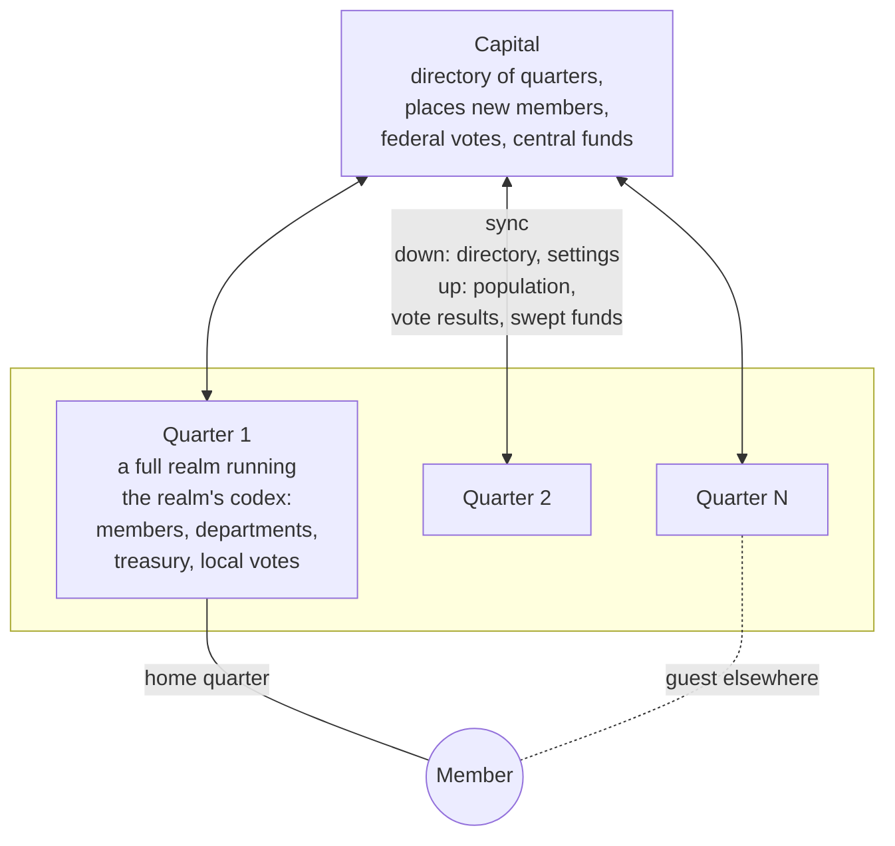
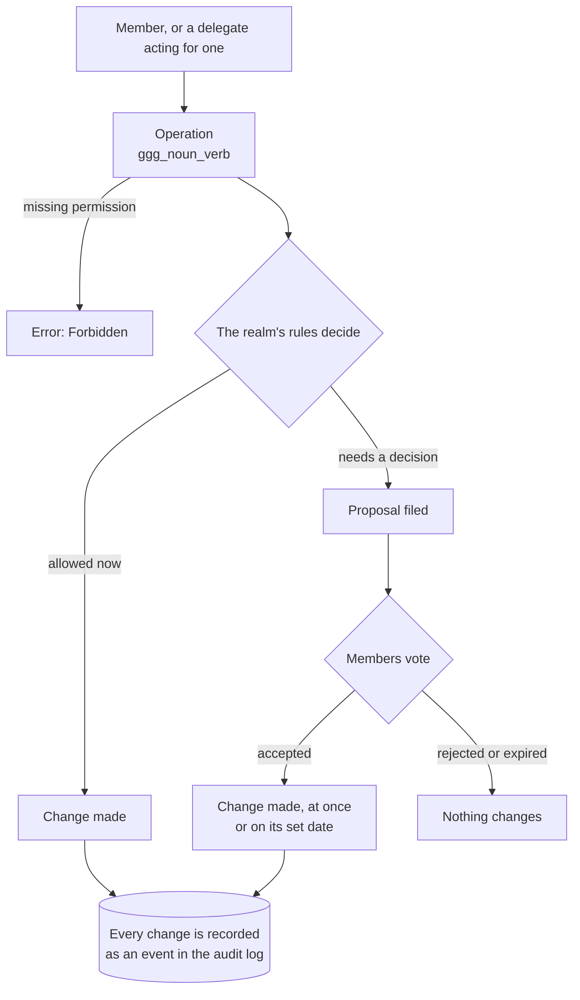

# Generalized Global Governance (GGG)

GGG is a standard for Governance Operating Systems (GOS) running on the [Internet Computer Protocol(ICP)](wwww.internetcomputer.org).

**Governance** is how a community makes and carries out its decisions: who may decide what, under which rules, and how it is recorded.
An **operating system** is the software that manages a computer's resources and lets programs share them safely.

A GOS is software that transparently and verifiably runs the governance processes of a city or a country, from government to public administration.

A GOS lets cooperation emerge, as it naturally does: corruption is harder to conceal, and cooperation can scale.

GGG describes the entities, processes and conventions that a GOS should implement. For example, GGG calls each place a GOS governs a **realm**: a city such as Tallinn, a region such as Catalonia, a country such as Kenya, or any other community that governs itself.

GGG has the following goals:

1. **Implementation-agnosticism:** it says what a GOS does, not how a GOS stores or runs it. The only requirement is that it must run on the Internet Computer.

2. **Interoperability:** any GGG-compliant GOS or tool works out-of-the-box with any GGG-compliant GOS or tool.

3. **Familiar but abstract:** close enough to traditional governance that existing institutions map onto it, yet general enough not to be tied to any one country or to limit governance evolution. See [Reference countries](#reference-countries).

**This page is the whole specification.** [`ggg.did`](ggg.did) is the same thing in Candid, the interface description language (IDL) for the ICP, and is normative for exact types and signatures. Where this page and `ggg.did` disagree, one of them needs fixing.

## Reference countries

GGG draws its examples from eight countries in three groups. Each group plays a different role.

| Group | Countries | Role |
|---|---|---|
| EU civil-law democracies | Spain, Germany, Estonia | **The base.** GGG must fit all three. They also share a layer above them: the EU. |
| Common-law democracies | United States, United Kingdom, India, Kenya | **The contrast.** A concept should work here too. If it does not, it is probably a European habit, not common ground. |
| One-party state | China | **The stress test** for administrative machinery, such as scale, deep layers and digital services. Never for how decisions are made. |

A rule belongs in GGG when it holds in the first group and in most of the second. A rule that holds in one country only belongs in a codex layer.

## Architecture

Each part of an operating system has a counterpart in a GOS:

| Operating system | GOS |
|---|---|
| Kernel | the core that checks permissions and runs every operation |
| Process management | proposals, votes and scheduled tasks |
| Resource management | treasury, funds and budgets |
| Communication between processes | sync between a capital and its quarters, and between linked realms |
| Security and access control | permissions, profiles and delegation |
| Input and output | notifications to members, dispatches to outside bodies, reports from them |
| System utilities and libraries | the codex, and the layers it inherits from other realms |
| Booting | realm setup, then launch |

The main parts of a GOS:

- **Realm:** the community a GOS governs.
- **Quarter:** part of a large realm, run as a realm of its own and coordinated by a capital.
- **User:** a person or an agent, identified by an Internet Computer principal, who becomes a member by joining a realm.
- **Permission:** the right to perform an operation, held directly or through a profile or department. Members can let a delegate act for them.
- **Organizations:** bodies outside the realm's government, such as companies, parties, unions and associations.
- **Departments:** the realm's own bodies, in a tree under a root department, each deciding by its own voting policy.
- **Codex:** the realm's legislation as code inside the GOS.

### Quarters

Two reasons shape quarters:

- **The Internet Computer.** A canister has plenty of memory and storage, but calls between canisters are slow. So a large realm is split by member, not by function: each quarter holds whole members, and most of their work stays inside one canister.
- **Forking.** If people can fork a GOS easily, corruption is harder to hide and cooperation can scale. A quarter is a complete realm, so it can secede (`ggg_quarter_secede`) and govern itself.

## Domains

GGG groups its entities and operations into twelve domains, numbered as in `ggg.did`. They share a few conventions, such as units of time and money, which `ggg.did` sets out first. Apart from those, each domain stands alone.

| # | Domain | What it covers |
|---|---|---|
| 1 | Identity and membership | Users and members, identity proofs, certified attributes, invites, profiles, permissions and delegation |
| 2 | Departments and organizations | Departments and their voting policies, outside organizations, positions and appointments |
| 3 | Governance | Proposals and votes, mandates, contracts and their amendments, and the realm's voting rules |
| 4 | Finance | Treasury, tokens, funds, budgets, a double-entry ledger, invoices, transfers, payroll, loans and taxes |
| 5 | Assets | Land parcels with their assessed value and zones, and credentials issued as tokens |
| 6 | Licensing | Licences, the procedure for each kind (including what silence after a deadline means, as in Spanish law) and petitions |
| 7 | Justice | Courts, judges, disputes, cases, evidence, verdicts, appeals and penalties |
| 8 | Procurement | Tenders and their lots, sealed bids, scoring, awards and published notices |
| 9 | Quarters and federation | The capital and its quarters, federal votes, swept funds, and links to realms whose legislation it follows |
| 10 | Codex, notifications and audit | The codex, legislation releases, notifications, messages to outside bodies, scheduled tasks and the event log |
| 11 | Realm setup | The realm's settings, setup and launch, upgrades and monitoring |
| 12 | Private content | Encrypted documents, the keys to read them, and sharing or publishing them |

## Layers

Legislation comes in layers. A realm can follow other realms, such as its region and its country, and add its own layer on top. A town in Catalonia, for example, follows the EU, Spain and Catalonia, and adds its own bylaws. Each source publishes releases, with the date each comes into force. A follower reports what it runs, and is non-compliant from the first release it misses. In a federation, a new codex reaches every quarter at the same moment.

splitting and merging

## Permissioning

Most operations need a permission, such as `attribute.review`. A member holds one directly, through their department, or through a **profile**: a named set of permissions, which a seat can carry. A missing permission gives a `Forbidden` error that can name it. Holding a permission is not always enough, because the realm's rules may still require a vote. An **agent**, such as an AI assistant, may hold a seat only with a supervisor who holds a non-agent seat in the same body.

## Operations

Everything happens through **operations**, the methods of `ggg.did`, named noun then verb, such as `ggg_proposal_vote` or `ggg_budget_draft`. Reads never change anything. An operation either succeeds or returns an error, and a refusal can name the permission that was missing.

**Decisions.** When the realm's rules reserve a change for a decision, the operation files a **proposal** instead of making the change. The members entitled to vote, in the whole realm or in one department, decide it under a threshold and quorum fixed when voting opens. In an Indian village assembly, for example, every adult in the village takes part. An accepted proposal takes effect at once, or on a date set when it was filed.

**Delegation.** A member can let a delegate act for them, limited to chosen groups of operations and to a period. Some operations still wait for the member's own approval each time.

**Legislation.** The codex attaches rules to operations. A realm can also take legislation from other realms, such as its region or its country, when both sides agree by vote, and GGG records whether it runs the latest release in force.

**Records.** Every change is recorded as an **event**: what was done, by whom, for whom and under which grant. Private documents are encrypted, and only people given a key can read them.

## Tasks

A **task** is an operation scheduled for later, such as a status change on a set date. It runs with the authority of whoever scheduled it. Every check and rule runs again at that time, so the task follows the legislation then in force.

## Onboarding / status

A new realm starts in **setup**: the founder named by its host configures it without votes. Launching moves it to **alpha**, and the later stages are beta, production, deprecation and terminated. After launch, every change follows the realm's rules.

## Examples

**A democratic vote.** A town decides whether to spend more on its parks.

1. A member files a proposal with `ggg_proposal_create`. Its action calls `ggg_budget_amend` to raise the parks budget line.
2. `ggg_proposal_open` starts the vote. Who may vote, the threshold and the quorum are fixed now.
3. Members vote yes, no or abstain with `ggg_proposal_vote`, themselves or through a delegate.
4. After the deadline, `ggg_proposal_finalize` counts the votes. The proposal passes if enough members voted (the quorum) and enough voted yes (the threshold).
5. `ggg_proposal_execute` amends the budget, at once or on the date set in the proposal.

Every step is recorded as an event.
