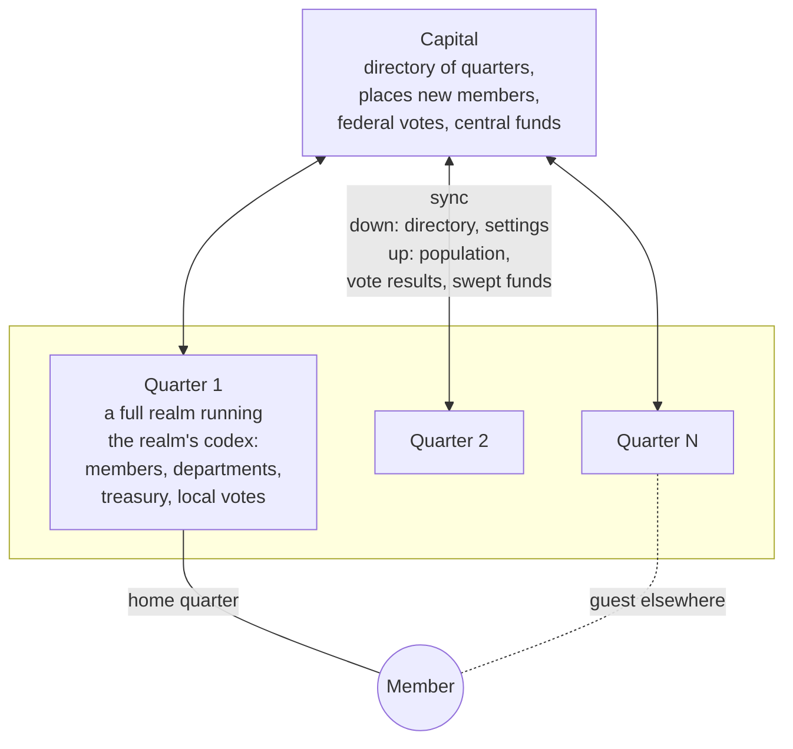
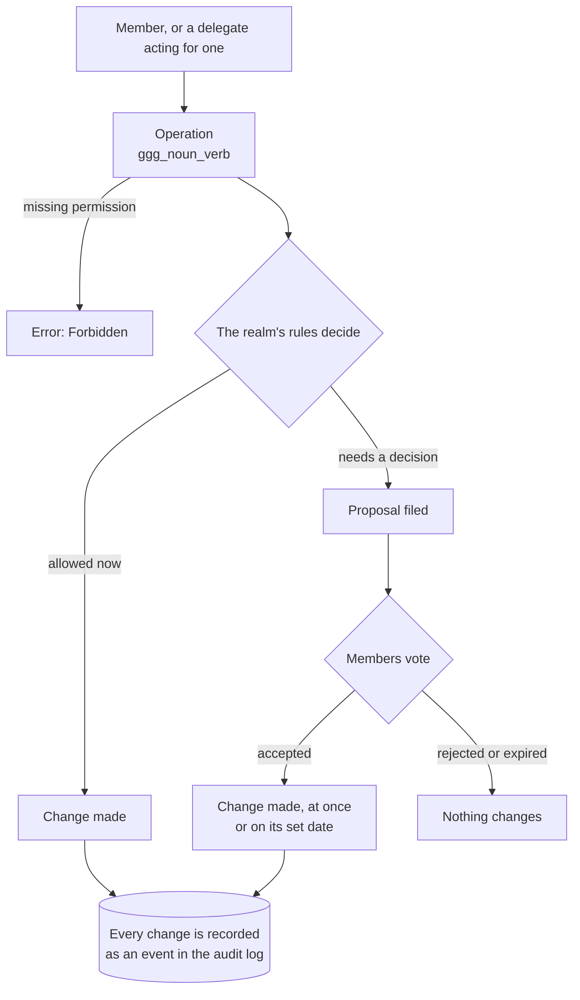

# Generalized Global Governance (GGG)

GGG is a standard for Governance Operating Systems (GOS) running on the [Internet Computer Protocol(ICP)](wwww.internetcomputer.org).

**Governance** is how a community makes and carries out its decisions: who may decide what, under which rules, and how it is recorded.
An **operating system** is the software that manages a computer's resources and lets programs share them safely.

A GOS is software that transparently and verifiably runs the governance processes of a city or a country, from government to public administration.

A GOS lets cooperation emerge, as it naturally does: corruption is harder to conceal, and cooperation can scale.

GGG describes the entities, processes and conventions that a GOS should implement. For example, GGG calls each place a GOS governs a **realm**: a city, a region, a country, or any other community that governs itself.

GGG has the following goals:

1. **Implementation-agnosticism:** it says what a GOS does, not how a GOS stores or runs it. The only requirement is that it must run on the Internet Computer.

2. **Interoperability:** any GGG-compliant GOS or tool works out-of-the-box with any GGG-compliant GOS or tool.

3. **Familiar but abstract:** close enough to traditional governance that existing institutions map onto it, yet general enough not to be tied to any one country or to limit governance evolution.

**This page is the whole specification.** [`ggg.did`](ggg.did) is the same thing in Candid, the interface description language (IDL) for the ICP, and is normative for exact types and signatures. Where this page and `ggg.did` disagree, one of them needs fixing.

## Architecture

Each part of an operating system has a counterpart in a GOS:

| Operating system | GOS |
|---|---|
| Kernel | the core that checks permissions and runs every operation |
| Process management | proposals, votes and scheduled tasks |
| Resource management | treasury, funds and budgets |
| Communication between processes | sync between a capital and its quarters, and between linked realms |
| Security and access control | permissions, profiles and delegation |
| Input and output | notifications to members, dispatches to outside bodies, reports from them |
| System utilities and libraries | the codex, and the layers it inherits from other realms |
| Booting | realm setup, then launch |

The main parts of a GOS:

- **Realm:** the community a GOS governs.
- **Quarter:** part of a large realm, run as a realm of its own and coordinated by a capital.
- **User:** a person or an agent, identified by an Internet Computer principal, who becomes a member by joining a realm.
- **Permission:** the right to perform an operation, held directly or through a profile or department. Members can let a delegate act for them.
- **Organizations:** bodies outside the realm's government, such as companies, parties, unions and associations.
- **Departments:** the realm's own bodies, in a tree under a root department, each deciding by its own voting policy.
- **Codex:** the realm's legislation as code inside the GOS.

### Quarters

Two reasons shape quarters:

- **The Internet Computer.** A canister has plenty of memory and storage, but calls between canisters are slow. So a large realm is split by member, not by function: each quarter holds whole members, and most of their work stays inside one canister.
- **Forking.** If people can fork a GOS easily, corruption is harder to hide and cooperation can scale. A quarter is a complete realm, so it can secede (`ggg_quarter_secede`) and govern itself.

## Domains

GGG groups its entities and operations into domains, one section of `ggg.did` each: identity and membership, departments and organizations, governance, finance, assets, licensing, justice, procurement, quarters and federation, codex and audit, realm setup, and private content. Apart from a few shared types, each section stands alone.

## Layers

Legislation comes in layers. A realm can follow other realms, such as its region and its country, and add its own layer on top. Each source publishes releases, with the date each comes into force. A follower reports what it runs, and is non-compliant from the first release it misses. In a federation, a new codex reaches every quarter at the same moment.

splitting and merging

## Permissioning

## Operations

Everything happens through **operations**, the methods of `ggg.did`, named noun then verb, such as `ggg_proposal_vote` or `ggg_budget_draft`. Reads never change anything. An operation either succeeds or returns an error, and a refusal can name the permission that was missing.

**Decisions.** When the realm's rules reserve a change for a decision, the operation files a **proposal** instead of making the change. The members entitled to vote, in the whole realm or in one department, decide it under a threshold and quorum fixed when voting opens. An accepted proposal takes effect at once, or on a date set when it was filed.

**Delegation.** A member can let a delegate act for them, limited to chosen groups of operations and to a period. Some operations still wait for the member's own approval each time.

**Legislation.** The codex attaches rules to operations. A realm can also take legislation from other realms, such as its region or its country, when both sides agree by vote, and GGG records whether it runs the latest release in force.

**Records.** Every change is recorded as an **event**: what was done, by whom, for whom and under which grant. Private documents are encrypted, and only people given a key can read them.

## Tasks

A **task** is an operation scheduled for later, such as a status change on a set date. It runs with the authority of whoever scheduled it. Every check and rule runs again at that time, so the task follows the legislation then in force.

## Onboarding / status

A new realm starts in **setup**: the founder named by its host configures it without votes. Launching moves it to **alpha**, and the later stages are beta, production, deprecation and terminated. After launch, every change follows the realm's rules.

## Examples

democratic vote
